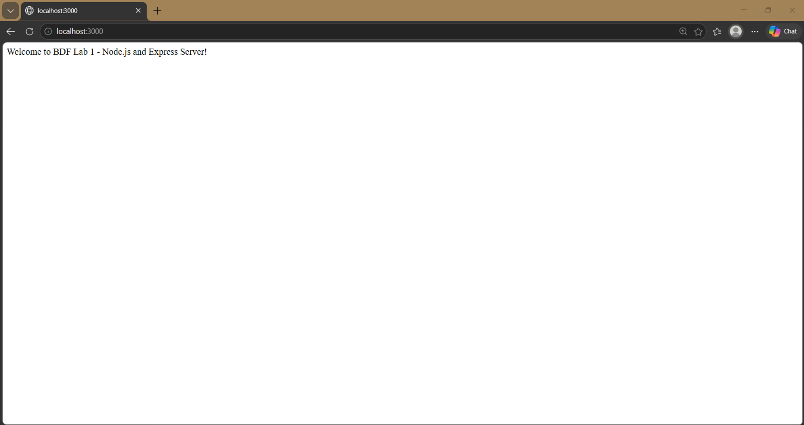
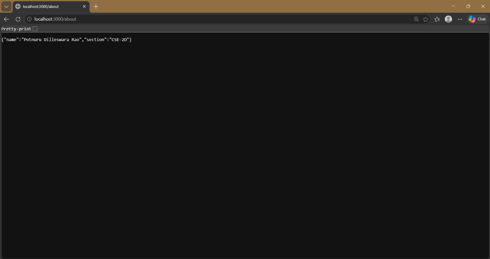
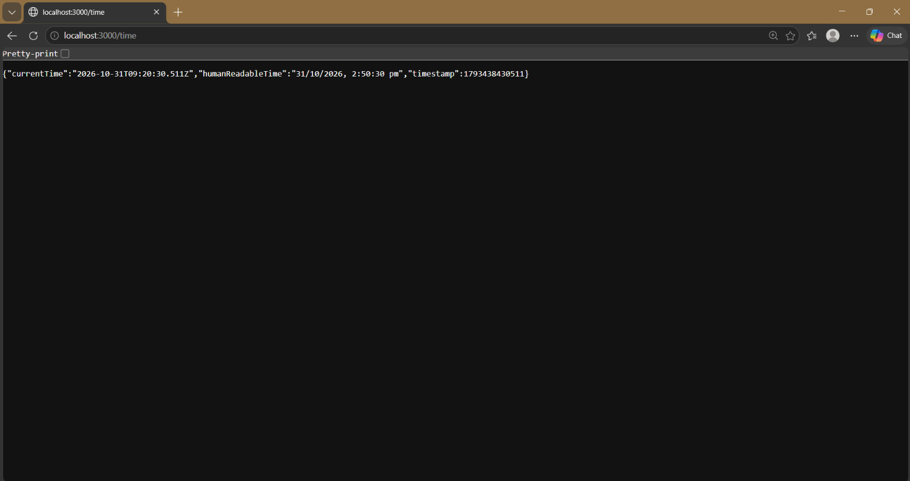
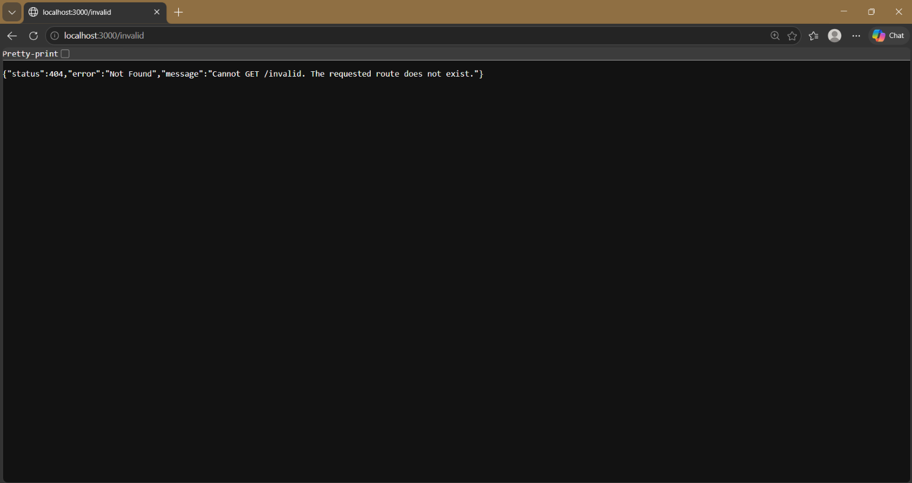

# Lab 1: Node.js and Express Server

**Course:** Backend Development Fundamentals (BDF)  
**Student Name:** Potnuru Dilleswara Rao  
**Registration Number:** 252U1R1198  
**Section:** CSE-2D  
**Live Deployment URL:** [https://bdf-lab-1-lnrg.onrender.com](https://bdf-lab-1-lnrg.onrender.com)

---

## 1. Project Overview
This lab assignment demonstrates the fundamentals of backend web development using **Node.js** and **Express.js**. It establishes a foundational understanding of how HTTP servers function by implementing two types of servers:
1. A basic HTTP server built using Node.js's native `http` module (`http-server.js`).
2. A modular web application server built using the `Express.js` framework (`server.js`), featuring structured routing, JSON response formatting, custom logging, and robust 404 error handling.

---

## 2. Objectives
- Understand the Node.js runtime and asynchronous server-side execution.
- Initialize and configure a Node.js project using `package.json`.
- Install, configure, and manage third-party packages via `npm`.
- Build a lightweight web server with the built-in Node.js `http` module.
- Build a structured web server using the `Express.js` framework.
- Implement HTTP `GET` endpoints with plain text and JSON responses.
- Implement custom 404 handling for unknown routes.
- Prepare and deploy an Express application to cloud platforms like **Render**.

---

## 3. Technologies Used
- **Node.js** (v24.x LTS): JavaScript runtime environment.
- **Express.js** (v5.x): Minimalist web application framework.
- **Built-in `http` module**: Native Node.js module used to create basic HTTP servers without external dependencies.
- **npm** (Node Package Manager): Dependency and script management tool.
- **Git & GitHub**: Version control and repository hosting.
- **Render**: Cloud hosting platform for backend web services.

---

## 4. Project Folder Structure
```text
BDF-LAB-1/
├── server.js              # Express web application server with routes and 404 handler
├── http-server.js         # Plain Node.js HTTP server using built-in 'http' module
├── package.json           # Project manifest, metadata, dependencies, and execution scripts
├── package-lock.json      # Exact dependency tree snapshot
├── .gitignore             # Excludes node_modules, .env, and OS-generated files
├── README.md              # Comprehensive project documentation
└── screenshots/           # Directory holding test execution screenshots
    ├── instructions.md    # Instructions on capturing required screenshots
    ├── home.png           # GET / route response screenshot
    ├── about.png          # GET /about route response screenshot
    ├── time.png           # GET /time route response screenshot
    └── 404.png            # GET /invalid (404) route response screenshot
```

---

## 5. Explanation of `package.json` Fields

The `package.json` file serves as the manifest and configuration hub of any Node.js project:

| Field | Description | Purpose in this Project |
| :--- | :--- | :--- |
| **`name`** | Unique identifier/name of the package or project in lowercase. | Identifies this lab as `"lab-01"`. |
| **`version`** | Current version number using Semantic Versioning (`MAJOR.MINOR.PATCH`). | Set to `"1.0.0"` for the initial lab release. |
| **`description`** | Short summary explaining what the project is. | Brief summary of the BDF Lab 1 project. |
| **`main`** | The primary entry point file of the application. | Set to `"server.js"` (the Express server). |
| **`scripts`** | Key-value dictionary defining executable terminal shortcuts. | Runs servers via `npm run start:http`, `npm run start:express`, etc. |
| **`keywords`** | Array of search terms for indexing the project. | Tagged with `["nodejs", "express", "backend", "bdf", "lab-01"]`. |
| **`author`** | Name and contact information of the project developer. | Set to student name (`"Potnuru Dilleswara Rao"`). |
| **`license`** | Open-source software license defining permissions and terms. | Set to `"ISC"`. |
| **`dependencies`**| Production packages and libraries required for the app to run. | Lists `"express": "^5.3.0"`. |

---

## 6. Installation Instructions

### Prerequisites
- Node.js (version 18 or above recommended)
- npm (bundled with Node.js)
- Git installed on your system

### Steps
1. Clone the repository:
   ```bash
   git clone https://github.com/dilleswararao34/BDF-LAB-1.git
   cd BDF-LAB-1
   ```
2. Install dependencies:
   ```bash
   npm install
   ```
   *Note: This command reads `package.json` and installs Express and its sub-dependencies into `node_modules`.*

---

## 7. Commands to Run the Project

### Running the Plain Node.js HTTP Server (Task 3)
To run the server built with the native `http` module:
```bash
npm run start:http
```
*Or directly using Node:*
```bash
node http-server.js
```
The server will start listening at:
`http://localhost:3000`

### Running the Express Application Server (Task 4 & 5)
To run the Express web application:
```bash
npm start
```
*Or:*
```bash
npm run start:express
```
*Or directly:*
```bash
node server.js
```
The server will start listening at:
`http://localhost:3000`

---

## 8. Endpoint Documentation

The Express server (`server.js`) exposes the following endpoints:

| Method | Path | Description | Expected Status | Response Type | Example Response |
| :--- | :--- | :--- | :---: | :--- | :--- |
| **GET** | `/` | Welcoming message | `200 OK` | `text/html` | `Welcome to BDF Lab 1 - Node.js and Express Server!` |
| **GET** | `/about` | Student information | `200 OK` | `application/json` | `{"name":"Potnuru Dilleswara Rao","section":"CSE-2D"}` |
| **GET** | `/time` | Current date and timestamp | `200 OK` | `application/json` | `{"currentTime":"2026-10-30T07:00:24.000Z",...}` |
| **GET** | `/invalid` | Unknown route handler | `404 Not Found` | `application/json` | `{"status":404,"error":"Not Found",...}` |

---

## 9. Testing Endpoints & Status Code Identification

### How to Identify HTTP Status Codes

#### A. Web Browser (Google Chrome / Edge / Firefox)
1. Open your browser and navigate to the desired endpoint (e.g., `http://localhost:3000/time`).
2. Press `F12` (or right-click anywhere and select **Inspect**) to open Developer Tools.
3. Switch to the **Network** tab.
4. Refresh the page (`Ctrl + R` / `Cmd + R`).
5. Click on the requested file name (e.g., `time` or `/`).
6. Look under **Headers** &rarr; **General** &rarr; **Status Code** (e.g., `200 OK` or `404 Not Found`).

#### B. Terminal / PowerShell (Using curl)
Run `curl.exe -i` to view the full HTTP response headers including the status code:
```bash
curl.exe -i http://localhost:3000/
curl.exe -i http://localhost:3000/about
curl.exe -i http://localhost:3000/time
curl.exe -i http://localhost:3000/invalid
```

#### C. Server Terminal Logging
In `server.js`, custom logging middleware has been implemented. Whenever a request completes, the server outputs the status code directly in the terminal:
```text
[12:29:53 pm] GET / -> HTTP 200
[12:30:06 pm] GET /about -> HTTP 200
[12:30:24 pm] GET /time -> HTTP 200
[12:30:44 pm] GET /invalid -> HTTP 404
```

#### D. Postman Procedure
1. Open Postman.
2. Create a new HTTP Request.
3. Set the method to **GET** and enter `http://localhost:3000/about`.
4. Click **Send**.
5. Observe the status indicator in the top right of the response panel showing **Status: 200 OK**.
6. Repeat for `http://localhost:3000/invalid` and observe **Status: 404 Not Found**.

---

## 10. Screenshots

> [!IMPORTANT]
> **Instructions for Capturing Screenshots:**
> Student details (`Potnuru Dilleswara Rao`, `CSE-2D`) are pre-configured in `server.js`. Start your Express server (`npm start`), open the URLs in your browser or Postman, and capture genuine screenshots. Save them into the `screenshots/` directory with the exact names below.

### 1. Home Route (`GET /`)
*Displays welcome message with HTTP 200 OK.*  


---

### 2. About Route (`GET /about`)
*Displays student name (Potnuru Dilleswara Rao) and section (CSE-2D) in JSON format with HTTP 200 OK.*  


---

### 3. Time Route (`GET /time`)
*Displays the current date and time using `new Date()` with HTTP 200 OK.*  


---

### 4. 404 Not Found Route (`GET /invalid`)
*Displays meaningful 404 error JSON response for unmatched routes.*  
 


---

## 11. Cloud Deployment Guide (Render)

This project is pre-configured for seamless deployment to [Render](https://render.com).

### Key Architectural Configurations in `server.js`
- **Dynamic Port Binding**: `const PORT = process.env.PORT || 3000;` ensures the app binds to whatever port Render assigns dynamically.
- **Host Binding**: Listening on host `0.0.0.0` ensures incoming web requests from the cloud proxy are received properly.

### Step-by-Step Deployment Instructions

1. **Push to GitHub**:
   Ensure all files (except `node_modules` and `.env`) are committed and pushed to your GitHub repository:
   ```bash
   git add .
   git commit -m "Complete BDF Lab 1: Node.js and Express Server"
   git push origin main
   ```

2. **Sign In to Render**:
   - Go to [render.com](https://render.com) and sign in using your GitHub account.

3. **Create a New Web Service**:
   - In the Render dashboard, click **New +** &rarr; **Web Service**.
   - Select **Build and deploy from a Git repository**.
   - Connect your `BDF-LAB-1` repository.

4. **Configure the Web Service Settings**:
   - **Name**: `bdf-lab-1-lnrg` (or your chosen service name)
   - **Region**: Choose the closest region (e.g., Singapore or Frankfurt)
   - **Branch**: `main`
   - **Root Directory**: Leave blank (root)
   - **Runtime**: `Node`
   - **Build Command**: `npm install`
   - **Start Command**: `node server.js` (or `npm start`)
   - **Instance Type**: `Free`

5. **Deploy & Retrieve URL**:
   - Click **Create Web Service**.
   - Wait for Render to build the dependencies and start the server.
   - Once the status displays **Live**, copy your public URL:
     `https://bdf-lab-1-lnrg.onrender.com`
   - Test your public routes in the browser:
     - `https://bdf-lab-1-lnrg.onrender.com/`
     - `https://bdf-lab-1-lnrg.onrender.com/about`
     - `https://bdf-lab-1-lnrg.onrender.com/time`
     - `https://bdf-lab-1-lnrg.onrender.com/invalid`

6. **Alternative: Postman Testing Screenshots**:
   If live cloud deployment cannot be completed due to account or network restrictions, test each route locally in Postman, take screenshots showing the route, response body, and status code, and save them in the `screenshots/` directory as acceptable assignment evidence.

---

## 12. Problems Faced and Solutions

| Problem Encountered | Root Cause | Solution Implemented |
| :--- | :--- | :--- |
| **Port Collision (`EADDRINUSE`)** | Attempting to run `server.js` while `http-server.js` is still running on port 3000. | Stopped the previous server process (`Ctrl + C` or process termination) before starting the other. |
| **`node_modules` accidentally pushed to Git** | Large directory of downloaded dependencies polluting the repository. | Added `node_modules/` to `.gitignore` at both repository root and `lab-01/` levels before committing. |
| **Cloud platform failing to route traffic** | Hardcoding `localhost` or port `3000` causes cloud load balancers to fail. | Configured `process.env.PORT || 3000` and bound the listener to host `0.0.0.0`. |
| **Unmatched URLs returning blank pages or crashing** | Lack of a fallback catch-all handler for undefined paths. | Implemented a dedicated 404 middleware (`app.use((req, res) => {...})`) placed after all valid route definitions. |

---

## 13. Conclusion
In this lab, we successfully created and tested both a native Node.js HTTP server and a structured Express.js server. We implemented required GET endpoints returning plain text and JSON data, added a robust 404 handler for undefined routes, and configured production-ready deployment settings for Render. The project follows all standard Node.js development conventions, version control hygiene, and academic requirements for BDF Lab 1.
